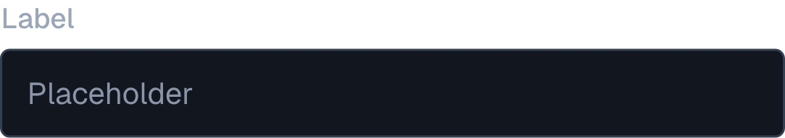
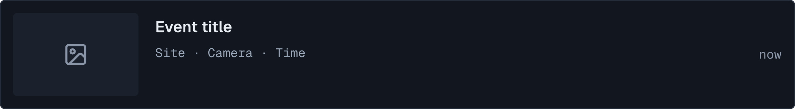
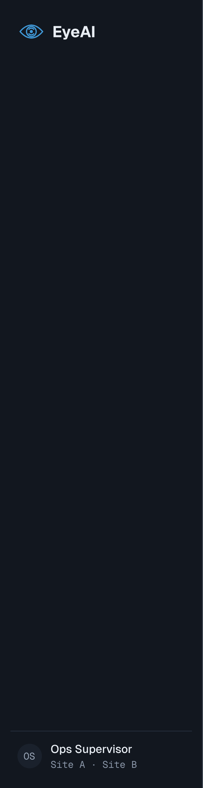
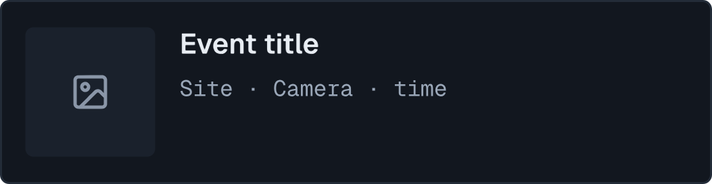

# EyeAI design system

Snapshots of the EyeAI console mockups, exported from the Pencil file `EyeAI.pen`. The `.pen` file is the source of truth and is not part of this folder; these PNGs are reference only.

All data in the mockups is illustrative. Live view and playback, the central server, the server-side classification worker and report sending do not exist in the engine yet (see the project README).

## Foundations

Dark operations console. Colour carries severity and state only; everything else is neutral.

| Token | Value | Use |
|---|---|---|
| `bg` | `#0B0E13` | Page ground |
| `surface` | `#12171F` | Panels |
| `surface-2` | `#1A212C` | Selected rows, thumbnails, dialogs |
| `border` | `#232C38` | Quiet rules |
| `border-strong` | `#334052` | Inputs, outlined controls |
| `text` | `#E8EDF3` | Primary text |
| `text-2` | `#9AA7B8` | Supporting text |
| `text-3` | `#8A96A8` | Labels, placeholders |
| `accent` | `#4A9FD8` | Action and selection |
| `accent-ink` | `#06121C` | Text on accent |
| `sev-critical` | `#FF6B6B` | Critical |
| `sev-high` | `#FFA94D` | High, degraded |
| `sev-medium` | `#F2D45C` | Medium |
| `sev-low` | `#8FA3B8` | Low |
| `ok` | `#3DD68C` | Healthy, online |

Severity backgrounds use the same hue at 12% alpha (`-bg` tokens).

Type: Geist for interface text, Geist Mono for IDs, timestamps and caps labels. Radius: 4 px (`r-sm`) for controls and cards, 8 px (`r-lg`) for dialogs. Page titles are 26 px on desktop and 24 px on mobile.

Brand mark: [`brand/logo-mark.png`](brand/logo-mark.png).

## Rules the components follow

- Severity is never shown by colour alone: every pill has a text label.
- Classification always shows label, confidence and source (`EDGE`, `CLASSIFIER`, `VLM`).
- AI-written text carries the `AI-GENERATED` tag and is read-only.
- No component triggers a physical action (doors, gates, machines).

## Component boards

- [Core](boards/components-core.png): buttons, input, severity, pipeline status, classification badge, event card.
- [Shell](boards/components-shell.png): nav items, filter chip, sidebar, open chip, health chips, AI tag.
- [Mobile](boards/components-mobile.png): status bar and event card.

## Components

| Component | Snapshot |
|---|---|
| Button/Primary |  |
| Button/Secondary |  |
| Button/Ghost |  |
| Input/Field |  |
| Severity/CRITICAL |  |
| Severity/HIGH |  |
| Severity/MEDIUM |  |
| Severity/LOW |  |
| Status/RECEIVED |  |
| Status/QUEUED |  |
| Status/CLASSIFYING |  |
| Status/READY FOR TRIAGE |  |
| Badge/Classification |  |
| Card/Event |  |
| Nav/Item |  |
| Nav/Item Active |  |
| Filter/Chip |  |
| Shell/Sidebar |  |
| Chip/Open |  |
| Health/Healthy |  |
| Health/Degraded |  |
| Tag/AI |  |
| Mobile/Status Bar |  |
| Mobile/Event Card |  |

## Screens

English is the primary language; the Indonesian set is a separate copy of each screen.

| Screen | English | Indonesian |
|---|---|---|
| Login | [default](screens/en/login-default.png), [error](screens/en/login-error.png) | [default](screens/id/login-default.png), [error](screens/id/login-error.png) |
| Triage | [en](screens/en/triage.png) | [id](screens/id/triage.png) |
| Incident detail | [en](screens/en/incident-detail.png) | [id](screens/id/incident-detail.png) |
| Overview | [en](screens/en/overview.png) | [id](screens/id/overview.png) |
| Sources & health | [en](screens/en/sources-health.png) | [id](screens/id/sources-health.png) |
| Cameras (design target) | [en](screens/en/cameras.png) | [id](screens/id/cameras.png) |
| Rules (read-only) | [en](screens/en/rules.png) | [id](screens/id/rules.png) |
| Shift report | [en](screens/en/shift-report.png) | [id](screens/id/shift-report.png) |
| States and confirmations | [en](screens/en/states.png) | [id](screens/id/states.png) |
| Mobile triage | [en](screens/en/mobile-triage.png) | [id](screens/id/mobile-triage.png) |
| Mobile event review | [en](screens/en/mobile-event-review.png) | [id](screens/id/mobile-event-review.png) |
| Mobile incident | [en](screens/en/mobile-incident.png) | [id](screens/id/mobile-incident.png) |

## Product decisions behind the screens

- A rule opens an incident immediately; Triage only re-checks the classification of the event (confirm or dismiss).
- Edge workers send snapshots only. The server classifies with a fixed-class classifier first and calls a VLM only on demand, within a per-site budget.
- Video is played from the site NVR; EyeAI stores snapshots and events, not recordings.
